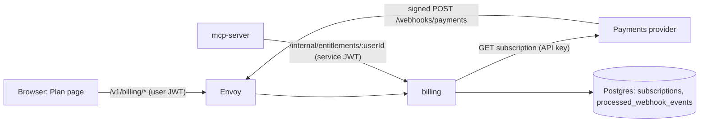
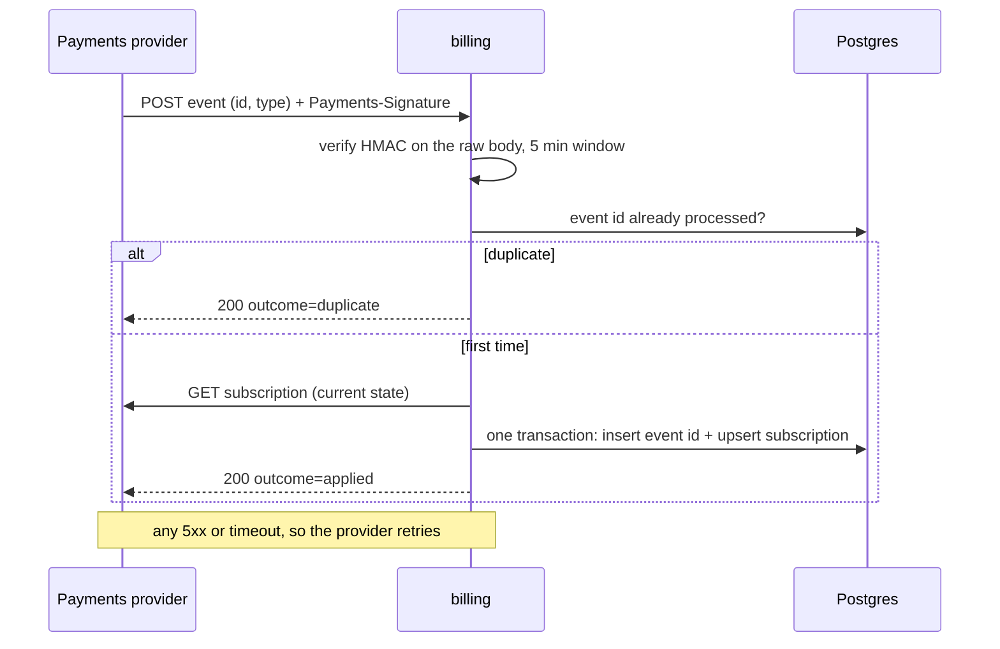

# billing

Subscriptions and entitlements. Node 24 + TypeScript, Fastify. Design and trade-offs:
[ADR 0010](../../docs/adr/0010-billing-webhook-is-a-nudge.md).

A webhook delivery, step by step. The event only says *what changed*; the state is re-read:

Three doors, three kinds of credential:

| Door | Path | Credential |
|---|---|---|
| Users (the Plan page) | `GET /v1/billing/subscription`, `POST /v1/billing/checkout` | user JWT, `aud = media-api` |
| Other services | `GET /internal/entitlements/:userId` | service JWT, `aud = media-billing`, only `service-account-media-mcp-billing` |
| The payments provider | `POST /webhooks/payments` | HMAC signature on the raw body |

## Layout

| Path | Job |
|---|---|
| `src/main.ts` | composition root |
| `src/http/` | Fastify app, error mapping, the two auth hooks |
| `src/webhooks/` | `signature.ts` (verify), `service.ts` (dedupe, re-fetch, store), `repository.ts` (SQL) |
| `src/subscriptions/` | `entitlement.ts` (the access rule), own subscription + checkout |
| `src/entitlements/` | the yes/no endpoint other services call |
| `src/adapters/` | Postgres pool, the payments provider's HTTP API |

## Talks to

`edge` (Keycloak JWKS, the provider) and `data` (Postgres only, as `billing_user`: `subscriptions`
and `processed_webhook_events`). No Kafka, no Redis. The webhook dedupe is a primary key, so
it can run with several replicas.

## Try it

`make demo` (steps B1–B7), or sign in to the web app and open **Plan**. Provider levers by hand:
see [fake-payments](../fake-payments/README.md).
