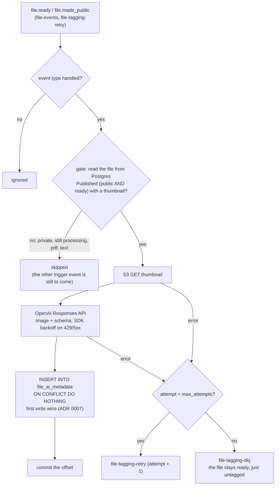

# tagger

Asks a vision model to caption and tag every image once it is ready. Python 3.14, a Kafka
consumer in its own group `tagger`. Not reachable from the internet: `data` network only,
no HTTP server. It is the one app that calls out to the internet (OpenAI, Langfuse).

Only **Published files** are ever sent to OpenAI (ADR 0008): a private file is skipped, and
tagged later if its owner makes it public.

Why a service of its own: a model call is slow, rate-limited, paid and flaky, so it must
not sit inside the processor's lease. Uploads become `ready` as before; the caption shows
up seconds later, and if the model is down the file simply stays untagged.

## Flow



The tagger never changes the File: no status update, no event.

## Layout

```
src/
  main.py          composition root: wire the parts, export LLM spans to Langfuse, run the loop
  config.py        env → Config (model, retries, Langfuse keys)
  kafka_loop.py    poll → handle → commit (copy of the processor's loop, minus the reaper)
  tracing.py       second OTLP exporter: gen_ai.* spans → Langfuse
  pipeline/        handler.py (what happens to one event, retry/DLQ)
  adapters/        llm.py (OpenAI + the generation span), db.py (the Published gate + insert), s3.py, events.py
  log.py           JSON logs with trace ids
```

## Guarantees and limits

- **At-least-once**, like every consumer here. A redelivery calls the model again and the
  insert loses: the first caption is kept (ADR 0007). No claim or lease: nothing else is
  at stake, and a repeat costs a fraction of a cent.
- Retries happen twice: the OpenAI SDK retries 429/5xx/timeouts with backoff inside one
  attempt (`openai_max_retries`), then the retry topic. The retry topic has no delay yet
  (roadmap Phase 4), and it cannot tell a permanent error (deleted thumbnail) from a
  transient one: both burn all attempts, then land in the DLQ.
- A new consumer group starts at `earliest`: the first start re-reads every `file.ready` and
  `file.made_public` still in the topic and tags (and pays for) every file that is Published now.
- Un-publishing doesn't un-send what was already sent, and the model call is not atomic with
  the visibility check (a window of one call).
- The tagger announces nothing (no `file.tagged`): a caption appears on the next load.

## Talks to

- **Kafka**: consumes `file-events` + `file-tagging-retry`; produces only to
  `file-tagging-retry` and `file-tagging-dlq`.
- **Postgres** (`tagger_user`): `INSERT` on `file_ai_metadata`, and `SELECT` on four columns
  of `files` (`id, visibility, status, thumbnail_key`) for the Published gate.
- **S3**: reads thumbnails only (its own identity).
- **OpenAI**: the thumbnail's bytes (webp, a few KB) of Published files go to the Responses
  API. See "AI provider calls" in [SECURITY.md](../../docs/SECURITY.md).
- **Langfuse Cloud**: `gen_ai.*` spans only (model, tokens, prompt text, answer; never the image).

## Config (env)

`DATABASE_URL`, `KAFKA_BROKERS`, `S3_ENDPOINT`, `S3_ACCESS_KEY`, `S3_SECRET_KEY`,
`OPENAI_API_KEY`; optional `OPENAI_MODEL` (default `gpt-5.4-nano`), `LANGFUSE_HOST`,
`LANGFUSE_PUBLIC_KEY`, `LANGFUSE_SECRET_KEY` (without them LLM spans go to Tempo only).
Set in `compose/apps.yml`; the secrets come from `.env`.

## Run

```bash
docker compose up -d --build tagger
docker compose logs -f tagger | grep -E "file tagged|retry|DLQ"
docker compose exec -T postgres psql -U postgres -d mediashare -c "select * from file_ai_metadata"
```
